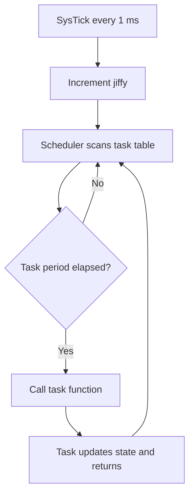

# Time-Triggered Cooperative Task Dispatcher

A small bare-metal cooperative task dispatcher for the **RaayanMini board based on STM32F401RBT6**. The project uses the Cortex-M SysTick timer to maintain a 1 ms software time base and periodically calls registered task functions from a static task table.

This project is intended for learning. It demonstrates how a basic scheduler can be built before introducing an RTOS such as FreeRTOS.

## Learning objectives

After studying this project, a learner should be able to explain:

- How SysTick can create a 1 ms system time base.
- Why an interrupt-shared variable must be declared `volatile`.
- How a function pointer can represent a task entry point.
- How a task control block stores scheduling information.
- How unsigned tick subtraction handles counter wraparound.
- Why cooperative tasks must finish quickly and return.
- Why changing a task period defers its next call but does not preserve its execution position.
- How a finite state machine preserves logical progress between task calls.
- Why busy-wait delays, long functions and shared resources become difficult as an application grows.
- Which limitations are addressed by FreeRTOS task states, priorities and synchronization APIs.

## Project behavior

The example controls two active-low LEDs connected to GPIOB.

| Task | Pin | Initial table period | Period requested by task | Complete ON/OFF cycle after startup |
|---|---:|---:|---:|---:|
| Red LED task | PB13 | 1000 ms | 1000 ms | 2000 ms |
| Green LED task | PB14 | 250 ms | 1000 ms | 2000 ms |

A complete blink cycle needs two task executions: one to toggle the LED ON and another to toggle it OFF. The scheduler force-runs both tasks during startup. During that first call, the Green LED task intentionally changes its future period from 250 ms to 1000 ms.

## How it works



The SysTick interrupt does not execute the application tasks. It only increments `jiffy`. The foreground scheduler reads that counter and dispatches a task when its configured period has elapsed.

## Task table

The scheduler uses a static array of task control blocks. The related header is expected to define `tick_t` as an unsigned 32-bit type:

```c
typedef uint32_t tick_t;
```

The task control block contains the information required by the dispatcher:

```c
typedef struct
{
    void (*task)(void);
    tick_t period;
    tick_t lastRunTime;
} tcb_t;
```

The exact type and member declarations should remain in `scheduler.h`; this representation is shown here to explain the design.

## Repository structure

```text
time-triggered-cooperative-task-dispatcher/
├── README.md
├── inc/
│   ├── gpio.h
│   ├── scheduler.h
│   ├── systick_timer.h
│   ├── tasks.h
│   └── stm32f401rbt6.h
└── src/
    ├── gpio.c
    ├── main.c
    ├── scheduler.c
    └── systick_timer.c
```

The `inc` headers are board and project specific. Add the existing Kernel Masters/RaayanMini headers to that directory before building the repository.

## Source files

| File | Responsibility |
|---|---|
| `main.c` | Initializes the LEDs and starts the time base and dispatcher |
| `scheduler.c` | Defines the static task table and cooperative dispatch loop |
| `systick_timer.c` | Configures the 1 ms SysTick interrupt and maintains `jiffy` |
| `gpio.c` | Enables GPIO clocks and configures STM32 GPIO modes |

## Scheduling algorithm

For every registered task, the dispatcher repeatedly performs this check:

```c
if ((taskList[i].period != 0U) &&
    ((tick_t)(now - taskList[i].lastRunTime) >= taskList[i].period))
{
    taskList[i].lastRunTime = now;
    taskList[i].task();
}
```

Because `tick_t` is an unsigned 32-bit type, the subtraction remains valid when `jiffy` wraps from `0xFFFFFFFF` to `0x00000000`, provided the required interval is less than half of the counter range.

## Cooperative execution rule

Every scheduled task must:

1. Perform a small amount of work.
2. Avoid an infinite loop.
3. Avoid a busy-wait delay.
4. Return control to the scheduler quickly.

The dispatcher cannot interrupt a running task. If one task takes 500 ms to return, every other task is delayed by at least 500 ms.

## Deferred reinvocation and task state

The LED tasks demonstrate how a cooperative task can defer its next execution without busy-waiting. Changing the period and returning releases the CPU so the dispatcher can run other tasks:

```c
taskList[1].period = 1000U;
return;
```

This creates a non-blocking waiting interval, but it does **not** preserve the point at which the task returned. When the period expires, the dispatcher calls the task as an ordinary C function, so execution starts again at the function's first statement. The scheduler does not save a separate program counter, register set, or stack for the task.

For multi-step work, the task must store its logical progress explicitly. The LED tasks use a finite state machine whose `static` state variable survives between function calls:

```c
typedef enum
{
    LED_STATE_OFF = 0,
    LED_STATE_ON
} led_state_t;

void task2_greenLedBlink(void)
{
    static led_state_t state = LED_STATE_OFF;

    switch (state)
    {
        case LED_STATE_OFF:
            GPIOB->ODR &= ~BIT(GREEN_LED_PIN); /* Active-low LED ON. */
            state = LED_STATE_ON;
            break;

        case LED_STATE_ON:
            GPIOB->ODR |= BIT(GREEN_LED_PIN);  /* Active-low LED OFF. */
            state = LED_STATE_OFF;
            break;

        default:
            GPIOB->ODR |= BIT(GREEN_LED_PIN);
            state = LED_STATE_OFF;
            break;
    }

    taskList[1].period = 1000U;
    return;
}
```

Each call still begins at the top of the function. The saved state selects the correct next operation, after which the task records its next state, requests a future dispatch interval, and returns.

An ordinary automatic local variable would be created again on every call and would not preserve the task's progress. Persistent state can be held in a `static` variable, a global object, or a field added to the task control block. This example uses a private `static` variable so each LED task owns its own state.

This is intentional. The initial `250U` value in the task table is replaced when the Green LED task is force-run during scheduler startup. It demonstrates that a task can change its own future period dynamically.

## About `KM_mdelay()`

`KM_mdelay()` is retained to demonstrate a bare-metal limitation. It continuously waits for `jiffy` to advance. Calling it before the scheduler starts may be acceptable for simple initialization, but calling it from a scheduled task blocks the complete cooperative dispatcher. The tasks therefore update their scheduling period and return instead of calling `KM_mdelay()`.

This behavior creates a useful comparison with FreeRTOS:

- `KM_mdelay()` keeps the processor busy and prevents other cooperative tasks from running.
- `vTaskDelay()` places only the calling FreeRTOS task into the Blocked state, allowing another Ready task to execute.
- This dispatcher calls a task again from its function entry, so the application must preserve logical progress in a state machine.
- FreeRTOS gives each task its own stack and saves its execution context, allowing the task to continue after `vTaskDelay()` when it becomes Ready again.

## Clock assumption

The SysTick driver currently uses:

```c
#define SYSTICK_INPUT_CLOCK_HZ 16000000U
```

This is correct only while the processor clock supplied to SysTick is 16 MHz. Update this value if the RCC configuration changes the core clock. With the processor clock selected as the SysTick source, the 1 ms reload value is calculated as:

```text
reload = (processor clock / 1000) - 1
```

For 16 MHz:

```text
reload = (16,000,000 / 1000) - 1 = 15,999
```

## Building the project

1. Create a bare-metal STM32F401RBT6 project in the selected IDE.
2. Confirm that the base project compiles correctly.
3. Add the files from `src` to the build.
4. Add the project and board headers under `inc`.
5. Add `inc` to the compiler include path.
6. Confirm that the processor/SysTick input clock is 16 MHz, or update `SYSTICK_INPUT_CLOCK_HZ`.
7. Build and flash the project to the RaayanMini board.

## Expected sequence

1. `main()` enables GPIOB and configures PB13 and PB14 as outputs.
2. Both active-low LEDs are initially switched OFF.
3. `systickInit()` starts the 1 ms SysTick interrupt.
4. `startScheduler()` calls each registered task once.
5. The scheduler continuously checks each task's elapsed time.
6. A due task reads its saved state, performs one LED action, stores the next state and returns immediately.

## Intentional limitations

This dispatcher is intentionally small. It does not provide:

- Pre-emptive task switching.
- Task priorities.
- Independent task stacks.
- Ready, Blocked, Suspended or Deleted task states.
- Queues, semaphores, mutexes or event groups.
- Deadline or execution-overrun detection.
- Dynamic task creation or deletion.
- Power-aware idle or tickless operation.
- Protection against a task that never returns.

The dispatch loop also keeps the processor active while it waits for the next task period.

## From this dispatcher to FreeRTOS

| Bare-metal concept | FreeRTOS equivalent or improvement |
|---|---|
| `taskList[]` | Kernel-managed task control blocks |
| `jiffy` | FreeRTOS tick count |
| Task updates `taskList[i].period` and returns | `vTaskDelay()` or `vTaskDelayUntil()` |
| Explicit state machine preserves logical progress | Kernel saves and restores each task's execution context |
| `KM_mdelay()` busy-wait | FreeRTOS Blocked state allows another Ready task to run |
| Fixed scan order | Priority-based scheduling |
| Ordinary task function calls | Tasks with independently allocated stacks |
| Shared global data | Queues, mutexes, semaphores and event groups |
| Continuously running dispatcher | Idle task and optional tickless idle |

FreeRTOS provides the mechanisms required to address these limitations, but application tasks must still be designed carefully. A high-priority task that never blocks can still prevent lower-priority tasks from executing.

The intended learning sequence is:

1. Observe how a busy-wait delay blocks every cooperative task.
2. Replace the busy wait with a period update and an immediate return.
3. Observe that the task is called again from its first statement.
4. Add a state machine to preserve the task's logical progress manually.
5. Compare that manual design with FreeRTOS task stacks, context switching and the Blocked state.

## Important transition note

This project owns `SysTick_Handler()` and implements `startScheduler()`. When moving the same application to FreeRTOS:

- Do not compile this custom scheduler as the application scheduler.
- Do not keep this custom `SysTick_Handler()` alongside the FreeRTOS SysTick handler.
- Allow the selected FreeRTOS Cortex-M4F port to provide SysTick, PendSV and SVC handling.
- Use FreeRTOS task and timing APIs instead of directly modifying `taskList[]`.

## Author

Prepared by **Hitesh Behera | Kernel Masters**
